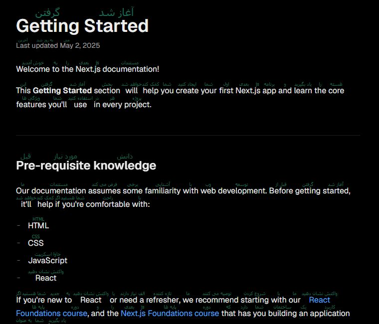

# WordYar — English-to-Persian (Farsi) Word Translator for Chrome

WordYar is a free Chrome extension for people learning English while reading technical documentation and other websites. It displays a small Persian translation above English words on the page, helping you read resources such as Next.js, NestJS, and TypeScript docs.

## Screenshot

Example from the Next.js documentation:

## Features

- Shows Persian (Farsi) meanings above English words in web pages.
- Turn translations on or off from the extension popup.
- Saves translated words in local extension storage for reuse.
- Skips code blocks, input fields, and editable content.
- Publicly available on GitHub.

## Install in Chrome

This repository is not currently distributed through the Chrome Web Store. To install it manually:

1. Download this repository using **Code → Download ZIP**, then extract the ZIP file. Alternatively, clone the repository.
2. Open `chrome://extensions` in Chrome.
3. Turn on **Developer mode**.
4. Select **Load unpacked** and choose the extracted `website-translator` folder containing `manifest.json`.
5. Open or refresh a webpage. Use the WordYar toolbar icon to turn translations on or off.

## How translation works

When enabled, the extension finds English words in readable page text and requests their English-to-Persian meanings from Google Translate's web translation endpoint. It caches successful translations in the extension's local storage. A network connection is needed for words that are not cached. Word-by-word translations may not match the meaning intended by a sentence or technical term.

The extension processes page text in your browser. It does not send the full page or code blocks to the translation service; individual English words are sent to request translations. It needs access to websites so it can read and annotate their text.

## Limitations

- Translations are word-by-word and may be inaccurate without sentence context, especially for technical terminology.
- Some sites use protected frames or unusual page structures that prevent the extension from reading their text.
- The translation endpoint is an unofficial web endpoint, not a paid or supported translation API, and may change or become unavailable.

## واژه‌یار: نمایش معنی فارسی بالای کلمات انگلیسی در Chrome

واژه‌یار یک افزونهٔ رایگان Chrome برای کسانی است که هنگام خواندن مستندات فنی و وب‌سایت‌های انگلیسی، زبان انگلیسی یاد می‌گیرند. افزونه معنی فارسی را با اندازهٔ کوچک بالای واژه‌های انگلیسی نمایش می‌دهد؛ مثلاً هنگام مطالعهٔ مستندات Next.js، NestJS و TypeScript.

### تصویر نمونه

این تصویر نمونه‌ای از نمایش ترجمه‌ها در مستندات Next.js است:

### امکانات

- نمایش معنی فارسی بالای واژه‌های انگلیسی در صفحهٔ وب
- روشن و خاموش کردن ترجمه از پنجرهٔ افزونه
- ذخیرهٔ محلی واژه‌های ترجمه‌شده برای استفادهٔ دوباره
- نادیده گرفتن کدها، کادرهای ورودی و بخش‌های قابل‌ویرایش
- در دسترس عموم در GitHub

### نصب دستی در Chrome

این افزونه فعلاً در Chrome Web Store منتشر نشده است. برای نصب دستی:

1. از دکمهٔ **Code → Download ZIP** این مخزن را دانلود و از حالت فشرده خارج کنید؛ یا مخزن را با Git کلون کنید.
2. در Chrome نشانی `chrome://extensions` را باز کنید.
3. گزینهٔ **Developer mode** را روشن کنید.
4. روی **Load unpacked** بزنید و پوشهٔ استخراج‌شدهٔ `website-translator` را که فایل `manifest.json` داخل آن است انتخاب کنید.
5. یک صفحهٔ وب را باز یا تازه‌سازی کنید. برای روشن یا خاموش کردن ترجمه از آیکن واژه‌یار در نوار ابزار استفاده کنید.

### روند ترجمه و حریم خصوصی

وقتی افزونه روشن است، واژه‌های انگلیسی را در متن قابل‌خواندن صفحه پیدا می‌کند و معنی آن‌ها را از سرویس وب ترجمهٔ گوگل می‌گیرد. معنی‌های دریافت‌شده در حافظهٔ محلی افزونه ذخیره می‌شوند؛ برای واژه‌های ذخیره‌نشده اتصال اینترنت لازم است. متن کامل صفحه و قطعه‌کدها برای ترجمه ارسال نمی‌شوند، اما خود واژه‌های انگلیسی برای دریافت معنی به سرویس ترجمه فرستاده می‌شوند. افزونه برای خواندن و حاشیه‌نویسی متن به دسترسی وب‌سایت‌ها نیاز دارد.

### محدودیت‌ها

- ترجمه‌ها واژه‌به‌واژه هستند و بدون جمله ممکن است با معنی موردنظر یا اصطلاحات فنی سازگار نباشند.
- بعضی سایت‌ها متن را در قاب‌های محافظت‌شده یا ساختارهایی نمایش می‌دهند که افزونه نمی‌تواند بخواند.
- این افزونه از یک نشانی وب غیررسمی برای ترجمه استفاده می‌کند، نه API رسمی و پشتیبانی‌شده؛ این سرویس ممکن است تغییر کند یا از دسترس خارج شود.
